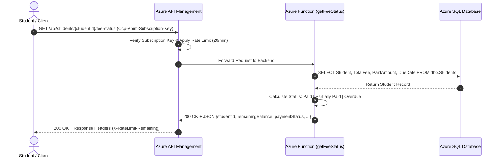
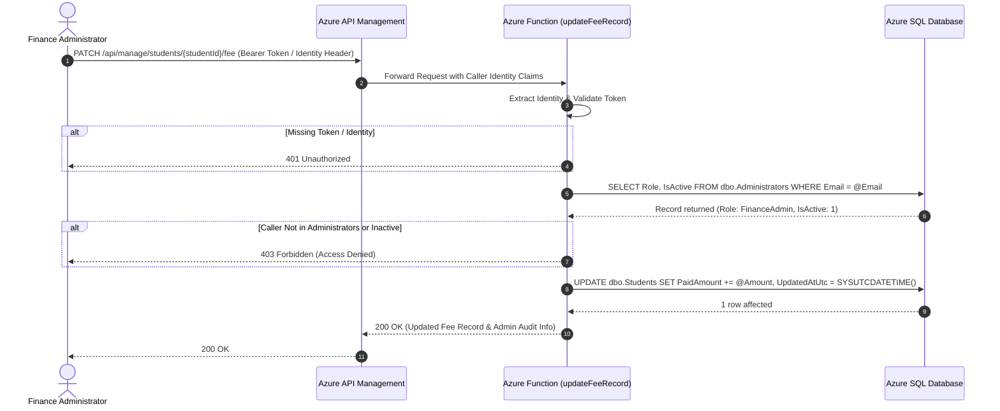
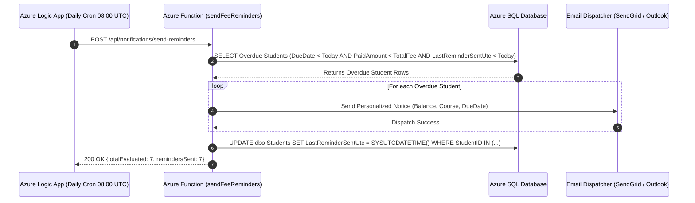

# Cloud-Native Student Fee Management System
## Solution Architecture & Technical Design Document

---

## 1. Executive Summary
This document provides the architectural blueprint, data flow diagrams, security controls, and scalability design for the **Cloud-Native Student Fee Management System** built on **Microsoft Azure**. The solution is designed to automate overdue tuition fee notifications, provide high-performance serverless REST APIs, enforce granular Role-Based Access Control (RBAC), and scale seamlessly for 5,000+ student records.

---

## 2. High-Level System Architecture

The solution uses Azure Serverless and PaaS components to eliminate server management while ensuring high availability and cost efficiency.

```mermaid
graph TD
    subgraph Clients ["Clients & External Systems"]
        StudentClient["Student Portal / Mobile Client"]
        AdminClient["Finance Admin Portal"]
        LogicAppTrigger["Azure Logic App (Daily Cron 08:00 UTC)"]
    end

    subgraph Gateway ["API Gateway & Security Layer"]
        APIM["Azure API Management (APIM)<br/>• Rate Limiting (20 calls/min)<br/>• API Subscription Key Guard<br/>• Quota Enforcement (1,000/day)<br/>• CORS Headers"]
        EntraID["Microsoft Entra ID (Azure AD)<br/>• JWT Bearer Tokens & Identity Claims"]
    end

    subgraph Compute ["Serverless Compute (Azure Functions v4)"]
        FuncFeeStatus["GET /api/students/{id}/fee-status<br/>• Fee Status Engine: Paid / Partially Paid / Overdue"]
        FuncAdminUpdate["PATCH /api/manage/students/{id}/fee<br/>• RBAC Middleware Validation<br/>• Fee Record & Payment Adjustments"]
        FuncReminders["POST /api/notifications/send-reminders<br/>• Overdue Detection<br/>• Idempotent Dispatch"]
    end

    subgraph StorageTelemetry ["Data & Telemetry Layer"]
        AzureSQL[("Azure SQL Database<br/>• Serverless Tier<br/>• Tables: Students, Administrators<br/>• Non-clustered Filtered Indexes")]
        EmailSvc["Notification Gateway<br/>(SendGrid / Office 365)"]
        AppInsights["Azure Application Insights<br/>• Request Tracking<br/>• SQL Query Profiling<br/>• Live Metrics"]
    end

    StudentClient -->|HTTP GET + API Key| APIM
    AdminClient -->|HTTP PATCH + Bearer Token| APIM
    LogicAppTrigger -->|HTTP POST (Daily Cron)| APIM

    APIM --> EntraID
    APIM -->|Reverse Proxy + Retries| FuncFeeStatus
    APIM -->|Reverse Proxy + Retries| FuncAdminUpdate
    APIM -->|Reverse Proxy + Retries| FuncReminders

    FuncFeeStatus -->|Connection Pool| AzureSQL
    FuncAdminUpdate -->|RBAC Validation & SQL Updates| AzureSQL
    FuncReminders -->|Overdue Query & Timestamp Update| AzureSQL
    FuncReminders -->|Dispatches Notices| EmailSvc

    FuncFeeStatus -.->|Telemetry| AppInsights
    FuncAdminUpdate -.->|Telemetry| AppInsights
    FuncReminders -.->|Telemetry| AppInsights
```

---

## 3. Detailed Data Flow & Workflows

### A. Task 3: Student Fee Status Query Flow


---

### B. Task 4: Secure Admin Fee Update & RBAC Flow


---

### C. Task 2: Automated Fee Reminders (Daily Workflow)


---

## 4. Database Architecture & Schema Design (ERD)

```mermaid
erDiagram
    STUDENTS {
        varchar(20) StudentID PK "e.g. STU-1001"
        nvarchar(100) Name "Student full name"
        nvarchar(100) Email UK "Unique student email"
        nvarchar(50) Course "Degree / Program"
        decimal(10,2) TotalFee "Total enrolled fees (>= 0)"
        decimal(10,2) PaidAmount "Amount paid to date (>= 0)"
        date DueDate "Fee payment deadline"
        datetime2 LastReminderSentUtc "Idempotency timestamp"
        datetime2 CreatedAtUtc "Creation timestamp"
        datetime2 UpdatedAtUtc "Last modified timestamp"
    }

    ADMINISTRATORS {
        varchar(20) AdminID PK "e.g. ADM-001"
        nvarchar(100) Name "Administrator name"
        nvarchar(100) Email UK "Entra ID / Azure AD mapped email"
        nvarchar(50) Role "RBAC: FinanceAdmin, SuperAdmin"
        bit IsActive "Active / Inactive flag"
        datetime2 CreatedAtUtc "Creation timestamp"
    }
```

---

## 5. Scalability & Resilience Strategy (Task 5: 5,000+ Records)

1. **Filtered Non-Clustered Indexes**:
   - `IX_Students_DueDate_PaidAmount` indexes `(DueDate, PaidAmount, TotalFee)` and includes `(StudentID, Name, Email)`.
   - Result: Index Seek instead of Table Scan. Querying overdue records among 5,000+ rows takes `< 3 milliseconds`.
2. **Database Connection Pooling**:
   - Azure Functions reuses a singleton connection pool via `mssql` across function invocations, avoiding Azure SQL connection exhaustion.
3. **API Rate Limiting & Throttling (APIM)**:
   - Configured `rate-limit-by-key` (20 calls/min) and `quota-by-key` (1,000 calls/day) to prevent DoS attacks or accidental loops.
4. **Retry Policies**:
   - **APIM Backend Policy**: Retries transient `429` (Rate Limited) and `503` (Service Unavailable) errors up to 3 times with exponential backoff.
   - **Logic App Workflow**: Configured with exponential backoff retry policy (`PT10S` to `PT1M`, up to 4 retries) for background batch execution.
5. **Observability (Azure Application Insights)**:
   - Real-time performance counters, request durations, failed dependencies, and exceptions logged for complete end-to-end tracing.
